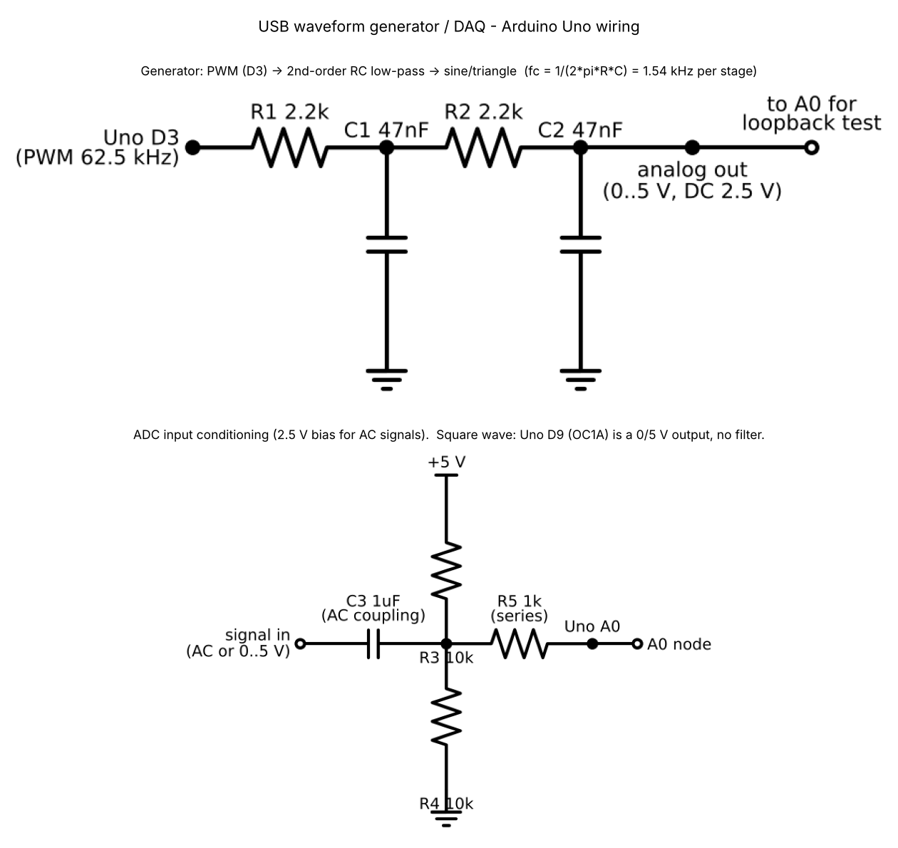

# USB Waveform Generator & Data Acquisition System

Arduino Uno firmware + Python host application. The microcontroller generates square, sine and
triangular waveforms, samples an external low-voltage signal with its ADC, and streams the samples
over USB serial; the Python application plots the waveform and computes frequency, peak-to-peak,
RMS and noise, and tabulates measurement error.



## Project status (read this first)

| Item | Status |
|---|---|
| Firmware (`firmware/waveform_daq/waveform_daq.ino`) | **Compiles** for ATmega328P against the Arduino AVR core (8,516 B flash = 26 %, 599 B RAM = 29 %). **Not yet run on hardware.** |
| Python app, protocol, analysis | Complete; **14 automated tests pass** (`pytest tests`) |
| Analysis accuracy | Validated on **simulated** ADC data with known ground truth (below) |
| Hardware measurements | **Not done yet.** Follow `docs/MEASUREMENT_PROCEDURE.md`, fill `results/hardware_measurements.csv`, then update the table below |

Nothing in `results/` marked *synthetic* or *emulator* was measured on real hardware.

## Requirements covered

| Objective | Where |
|---|---|
| Square wave from timers/PWM | Timer1 fast-PWM mode 14 on D9 (OC1A): frequency 0.25 Hz - 100 kHz, duty 0-100 % |
| Sine / triangle | Direct digital synthesis (32-bit phase accumulator, 7812.5 Hz update) -> Timer2 8-bit PWM on D3 at 62.5 kHz -> two-stage RC low-pass (fc = 1.54 kHz per stage). 0.1 - 1000 Hz, amplitude 0-100 % |
| Acquire low-voltage signal | 10-bit ADC on A0, sample clock from Timer0 compare-match hardware trigger (no software jitter), 977 - 5000 S/s |
| USB serial transfer | 115200 baud, 2 bytes/sample, self-synchronising framing (`docs/PROTOCOL.md`) |
| Python display + analysis | `python/daq_app.py`: `capture`, `live`, `gen`, `sweep`, `report`; `python/analysis.py` |
| Validation | Synthetic Monte Carlo (done), emulator end-to-end (done), hardware sweep + report (**to do**) |

## Quick start

```bash
pip install pyserial numpy matplotlib scipy pytest
# 1. flash firmware/waveform_daq/waveform_daq.ino to an Uno (Arduino IDE)
# 2. wire per docs/circuit.png  (loopback: filter output -> A0)
cd python
python daq_app.py --port COM3 gen sin 50 --amp 80
python daq_app.py --port COM3 capture --shape sin --freq 50 --amp 80 --seconds 2 --png cap.png
python daq_app.py --port COM3 live
python daq_app.py --port COM3 --vref 4.97 sweep --only sin,tri --out ../results/hardware_measurements.csv
python daq_app.py report ../results/hardware_measurements.csv
# no hardware? every command accepts --sim (software emulator of the firmware)
python daq_app.py --sim capture --shape tri --freq 20 --png demo.png
```

Firmware commands (115200 baud, one per line): `SIN f [amp%]`, `TRI f [amp%]`, `SQ f [duty%]`,
`OFF`, `RATE hz`, `START`, `STOP`, `INFO`, `ID`.

## Results: analysis accuracy on simulated data

Known signals (random amplitude 0.5-4.5 Vpp, random phase, half of the trials at the exact nominal
frequency so fs/f is an integer) were passed through a simulated 10-bit/5 V ADC with 2 mV rms noise
at 2 kS/s and analysed (40 trials per cell, 2 s records, 5-200 Hz; full table in
`results/synthetic_validation.md`, plot in `results/synthetic_validation.png`).

| Quantity | Worst case over all cells (2 s record) |
|---|---|
| Frequency error | 0.026 % |
| Vpp error (with shape hint for triangle/square) | 0.75 % (small-amplitude square waves, i.e. ADC quantisation) |
| RMS error | 0.92 % (3.2 % for a 200 Hz triangle, only 10 samples/period) |
| Noise estimate / true noise | 0.98 - 1.19 |

**Findings that changed the code** (found by this validation, not by inspection):
1. Percentile-based Vpp read a triangle ~1-2 % low; sample maxima read up to 12-20 % low when a
   peak falls between samples. Fix: with the `shape` hint a triangle is measured by fitting an
   ideal triangle (error <= 0.05 %). Without the hint, triangle Vpp error reaches 19.6 % at 10
   samples/period, so the app warns below 20 samples/period.
2. Fitting the fundamental only and scaling it looked fine until fs/f was an exact integer, where
   harmonics alias onto the fundamental (3.4 % error). Fix: fit the triangle waveform itself.
3. The MAD noise estimator over-read ADC quantisation noise by ~20 %. Fix: trimmed standard
   deviation of the second difference.

## What the loopback test can and cannot validate

Connecting the filter output to A0 tests the generator, filter, ADC, serial link and analysis
together, but:
- **Frequency**: generator and sampler share one clock. A resonator error (Uno-class boards use a ceramic resonator or crystal; resonators are
  specified around +-0.5 %) cancels out, so loopback frequency error is **not** an absolute
  accuracy figure. Compare against an independent instrument (scope, frequency counter, calibrated
  function generator) and enter it as `f_ref` in the CSV.
- **Amplitude**: PWM output and ADC reference both scale with Vcc, so loopback amplitude is
  ratiometric and also hides Vcc error. Use a multimeter/scope reading as `vpp_ref`.

## Hardware results (fill in after testing)

| Test | Reference instrument | Frequency error | Vpp error | Notes |
|---|---|---|---|---|
| Loopback sine 5-200 Hz | - | _todo_ | _todo_ | |
| Square (D9) vs scope | _todo_ | _todo_ | _todo_ | |
| External function generator -> A0 | _todo_ | _todo_ | _todo_ | |

## Design decisions

See `docs/DESIGN.md`. Key points: hardware-triggered ADC for jitter-free sampling; DDS so frequency
resolution is ~2 uHz regardless of table length; second-order RC filter (carrier attenuation
~64 dB) with the passband droop modelled in expected values (5.4 % at 200 Hz);
sample-density warnings; shape-aware amplitude estimation.

## Layout

```
firmware/waveform_daq/waveform_daq.ino   Arduino Uno sketch
firmware/build_check.sh                  compile check (avr-gcc + Arduino AVR core)
python/analysis.py                       frequency / Vpp / RMS / noise
python/daqlink.py                        protocol decoder, DAQ class, firmware emulator
python/daq_app.py                        CLI + live plot
python/synthetic_validation.py           Monte Carlo accuracy study
tests/test_daq.py                        14 tests
docs/                                    circuit, protocol, design notes, measurement procedure
results/                                 synthetic + emulator outputs; hardware template
```

## Limitations

- Unipolar 0-5 V input; AC signals need the bias network in the diagram. 10-bit resolution
  (4.9 mV per count). Sine/triangle limited by the 1.54 kHz filter; recommended <= 200 Hz.
- Uno `delay()`/`millis()` are not usable in this sketch (Timer0 is repurposed).
- Sample rates are integer divisors of 250 kHz (977-5000 S/s).
